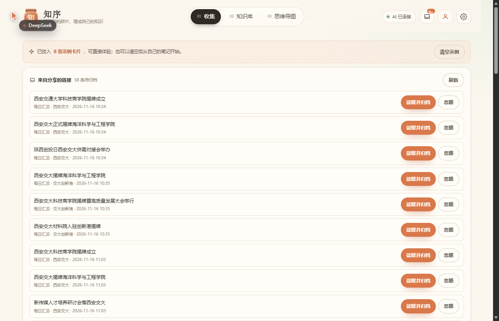
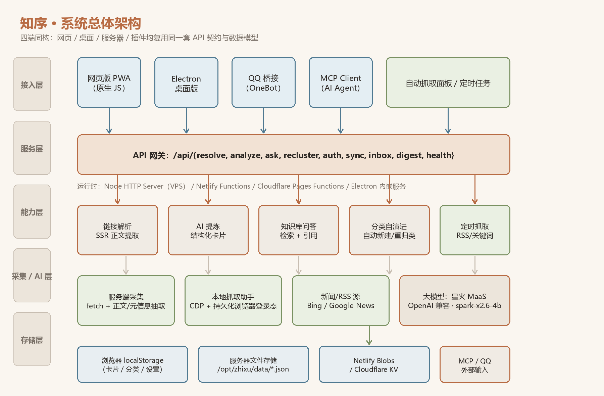

# 知序 · Zhixu

> 把刷到的碎片，理成自己的知识。
> 粘贴文字 / 分享链接 → AI 提炼成知识卡片 → 自动归档成谱系 → 可交互的思维导图 → 基于卡片的问答。

**在线演示：<http://47.86.32.77:8080/>**（评审期间保持可用）



---

## 目录

- [项目介绍](#项目介绍)
- [功能特性](#功能特性)
- [技术架构](#技术架构)
- [目录结构](#目录结构)
- [快速开始](#快速开始)
- [环境变量](#环境变量)
- [API 一览](#api-一览)
- [测试](#测试)
- [部署](#部署)
- [已知限制](#已知限制)
- [文档索引](#文档索引)
- [团队信息](#团队信息)
- [开源协议](#开源协议)

---

## 项目介绍

信息获取的主阵地已经从搜索引擎迁移到内容社区与订阅流（小红书、公众号、知乎、B 站、RSS）。
对个人而言，问题不再是「找不到内容」，而是「刷到的好内容留不下来」——收藏夹变成坟场，看完即忘。

知序把这件事拆成四步，形成一个闭环：

1. **输入**：粘贴文字、贴链接自动抓正文、批量导入、抓评论，或由服务器定时抓取。
2. **提炼**：大模型把原文提炼成固定字段的知识卡片（结论 / 要点 / 标签 / 分类 / 主题 / 核心短语）。
3. **组织**：按「分类 → 主题 → 卡片」聚合成谱系，并生成合并式的思维导图。
4. **使用**：基于已有卡片问答（带引用），分类可自定义、也可由 AI 自动归纳。

核心设计：卡片只留「以后还会用到」的部分；每张卡片带来源；数据默认存在自己的浏览器 / 服务器。

## 功能特性

| 模块 | 能力 |
|---|---|
| 收集 | 粘贴文字、贴链接抓正文（公众号 / 豆瓣 / B 站 / 普通网页）、批量导入、抓评论 |
| AI 提炼 | 标题 / 一句话结论 / 3–4 条要点 / 标签 / 分类 / 主题 / 核心短语 / 原文金句，严格 JSON 输出 |
| 知识库 | 分类树、搜索、排序、卡片编辑、JSON 导入导出 |
| 思维导图 | 按分类 → 主题 → 卡片自动成图，同主题合并（×N），拖拽 / 缩放 / 导出 |
| 问答 | 基于已有卡片检索 + 引用回答，不编造 |
| 分类管理 | 自定义增删改；AI 按需新建分类；一键「AI 整理分类」全局重归类 |
| 自动抓取 | 关键词 / RSS / 固定链接，运行时间与开关可视化配置，结果进收件箱 |
| 账号 | 注册登录、绑定接收 QQ、云同步（push / pull 合并） |
| 收件箱 | 自动抓取与外部分享的「待确认」缓冲区，确认后才入库 |
| 多端 | 网页（PWA）、Electron 桌面版、MCP Server（供 AI Agent 调用）、QQ 桥接 |

## 技术架构



- **前端**：原生 JavaScript（无框架）+ CSS，零构建依赖；数据存 `localStorage`，支持 PWA。
- **服务端**：Node.js 20 + 内置 `http` 模块（零框架），同时托管静态资源与 `/api/*`。
- **云函数**：Netlify Functions（`web/functions/`）与 Cloudflare Pages Functions（`cf/functions/`），同一 handler 契约。
- **AI**：星火大模型 MaaS（OpenAI 兼容协议，`spark-x2.6-4b`），服务端代理调用，key 不下发前端。
- **采集**：服务端 SSR 抽取（公开内容）+ 本地 CDP 抓取助手（登录态内容）+ Bing/Google 新闻 RSS。
- **存储**：浏览器 localStorage / 服务器 JSON 文件 / Netlify Blobs / Cloudflare KV（按运行时适配）。
- **桌面**：Electron 壳内嵌本地服务，并可自动拉起抓取助手。

更完整的设计说明见 [docs/知序技术文档.docx](docs/知序技术文档.docx)。

## 目录结构

```text
zhixu/
├── app/                     # 网页前端（原生 JS）：index.html / app.js / styles.css / server.py
├── web/                     # Netlify Functions 版后端与静态构建脚本
│   ├── functions/           # resolve / analyze / ask / recluster / auth / sync / inbox / digest / health
│   └── build.js             # 组装 dist（给 Netlify / VPS 共用）
├── cf/                      # Cloudflare Pages 版（ESM Functions + KV）
├── deploy/vps/              # VPS 部署：server.mjs / prepare.mjs / systemd / digest.mjs
├── desktop/                 # 轻量桌面壳（Node + 系统浏览器窗口）
├── electron/                # Electron 桌面版（内嵌服务、自动拉起助手）
├── integrations/
│   ├── xhs/                 # 多平台抓取助手（CDP，登录态）
│   ├── mcp/                 # MCP stdio Server（5 个工具）
│   ├── qq/                  # OneBot QQ 桥接
│   └── browser-extension/   # 浏览器采集扩展
├── tests/                   # 5 套自动化测试（60+ 断言）
├── docs/                    # 使用说明书、技术文档、架构图、截图
├── scripts/                 # 辅助脚本
└── miniprogram/             # 早期小程序原型（未上线，保留备查）
```

## 快速开始

### 方式一：只想看界面（零依赖）

直接双击 `app/index.html` 即可。默认使用示例数据与本地规则解析（不需要 AI key）。

### 方式二：本地跑完整版（带 AI）

需要 Node.js 18+：

```bash
# 1. 配置模型 key（复制示例文件后填入真实值）
cp deploy/vps/env.example deploy/vps/.env
#    编辑 .env：WJ_LLM_API_KEY=你的 key

# 2. 构建前端并启动本地服务
node web/build.js --clean
node deploy/vps/prepare.mjs      # 组装 _pkg（dist + functions + server）
node deploy/vps/server.mjs       # 默认监听 80 与 8080
```

打开 <http://127.0.0.1:8080/>。如果 80 端口被占用，修改 `.env` 里的 `PORT`。

> 也可以使用 `app/server.py`（仅标准库的轻量后端，适合只想试 AI 提炼的场景）。

### 方式三：Cloudflare Pages / Netlify

- **Cloudflare Pages**：`cd cf && npm install && npm run build`，用 `wrangler pages deploy` 部署，KV 绑定 `ZHIXU_KV`。
- **Netlify**：`node web/build.js --clean`，站点目录 `web/dist`，函数目录 `web/functions`，
  环境变量见 [环境变量](#环境变量)，并安装 `@netlify/blobs`（`cd web && npm install`）。

### 方式四：桌面版

```bash
cd electron && npm install
npx electron .          # 开发运行
npm run build           # 打包 Windows 安装包（release/）
```

## 环境变量

| 变量 | 必填 | 说明 | 示例 |
|---|---|---|---|
| `WJ_LLM_API_KEY` | 是 | 星火 MaaS API Key | `your-spark-api-key` |
| `WJ_LLM_BASE_URL` | 否 | OpenAI 兼容接口地址 | `https://maas-api.cn-huabei-1.xf-yun.com/v2` |
| `WJ_LLM_MODEL` | 否 | 模型名 | `spark-x2.6-4b` |
| `WJ_LLM_EXTRA_BODY` | 否 | 额外请求体（如关闭 thinking） | `{"thinking":{"type":"disabled"}}` |
| `PORT` / `PORT2` | 否 | VPS 监听端口（双端口规避浏览器 HTTPS 强制升级） | `80` / `8080` |
| `ZHIXU_RATE_PER_HOUR` | 否 | 每 IP 每小时 AI 调用上限 | `60` |
| `ZHIXU_INBOX` | 否 | VPS 版是否启用收件箱 | `1` |
| `WJ_INBOX_TOKEN` | 否 | 收件箱写接口鉴权 token | 空 |

模板文件：`web/.env.example`、`cf/.dev.vars.example`、`deploy/vps/env.example`。
**仓库不包含任何真实密钥**，`.env` / `.dev.vars` / `env.production` 均已被 `.gitignore` 忽略。

## API 一览

| 接口 | 方法 | 说明 |
|---|---|---|
| `/api/health` | GET | 能力矩阵（mode / resolve / analyze / ask / inbox） |
| `/api/resolve` | POST | 链接正文解析（含 SSRF 防护） |
| `/api/analyze` | POST | 原文 → 结构化卡片（接收当前分类清单） |
| `/api/ask` | POST | 基于卡片问答（带引用） |
| `/api/recluster` | POST | 全库重新归类（返回新分类 + 映射） |
| `/api/auth` | POST | 注册 / 登录 / me / 绑定 QQ / 登出 |
| `/api/sync` | POST | 云同步 push / pull |
| `/api/inbox` | GET / POST / DELETE | 收件箱读取 / 投递 / 删除 |
| `/api/digest` | GET / POST | 自动抓取配置读取 / 保存 / 立即运行（需登录） |
| `/api/search`、`/api/comments` | POST | 平台搜索与评论采集（需本地助手） |

## 测试

```bash
node tests/integration.test.mjs    # 助手 + 线上 API（19 断言）
node tests/mcp.test.mjs            # MCP 协议与 5 个工具（17 断言）
node tests/portability.test.mjs    # 跨机器可移植性（12 断言）
node tests/vps.test.mjs            # 线上站点端到端（9 断言，可设 ZHIXU_TEST_SITE）
node tests/auth.test.mjs           # 账号与同步（14 断言，本地起服务）
```

## 部署

生产环境为阿里云香港（2 核 / 512 MiB）上的 Node 服务：

```bash
node web/build.js --clean
node deploy/vps/prepare.mjs
tar -czf zhixu-vps.tar.gz -C deploy/vps/_pkg .
scp zhixu-vps.tar.gz root@<host>:/tmp/
# 服务器上：解压到 /opt/zhixu，写入 .env，安装 systemd 服务
systemctl restart zhixu
```

`deploy/vps/` 内附 `server.mjs`（静态 + API 路由 + 限流）、`prepare.mjs`（组装）、
`digest.mjs`（定时抓取）、`server-setup.sh`（服务器初始化）。详见 [docs/使用说明书.docx](docs/使用说明书.docx)。

## 已知限制

- 小红书 / 知乎有登录墙与反爬，服务端无法直接读取，需要本机运行抓取助手（`integrations/xhs/`）。
- 部署为 HTTP（无证书），请勿存放敏感信息。
- 自动抓取依赖公开 RSS / 新闻源，不能抓登录态平台。
- 问答使用词面检索（轻量 RAG），语义召回有提升空间。
- 云同步为手动触发，不会自动同步。

## 文档索引

| 文档 | 说明 |
|---|---|
| [docs/使用说明书.docx](docs/使用说明书.docx) | 图文版使用说明（9 张截图，覆盖全部功能） |
| [docs/知序技术文档.docx](docs/知序技术文档.docx) | 参赛技术文档（架构 / AI 方案 / 实现 / 测试 / 创新点） |
| [docs/使用说明书.md](docs/使用说明书.md) | 使用说明 Markdown 版 |
| [app/README.md](app/README.md) | 前端与本地服务说明 |
| [web/README.md](web/README.md) | Netlify 部署说明 |
| [cf/README.md](cf/README.md) | Cloudflare Pages 说明 |
| [integrations/xhs/README.md](integrations/xhs/README.md) | 抓取助手说明 |
| [integrations/mcp/README.md](integrations/mcp/README.md) | MCP 工具接入说明 |
| [integrations/qq/README.md](integrations/qq/README.md) | QQ 桥接说明 |

## 代码规范约定

- **格式**：2 空格缩进、UTF-8、LF 换行（Windows 脚本除外，见 `.gitattributes`），由 `.editorconfig` 约束。
- **命名**：JS 使用 `camelCase`，常量用 `UPPER_SNAKE_CASE`，文件/目录用小写短横线。
- **注释**：每个模块顶部写明职责与路由；复杂逻辑（反爬、容错解析、降级策略）必须用中文注释说明「为什么」。
- **接口**：函数统一返回 `{ ok, ... }` 结构；错误信息面向用户可读，不泄露内部堆栈。
- **安全**：密钥只读环境变量；前端不接触模型 key；用户输入统一截断与转义。
- **提交**：遵循 Conventional Commits（`feat:` / `fix:` / `test:` / `docs:` / `chore:`）。

## 本地开发流程

```bash
# 修改前端后重新构建
node web/build.js --clean

# 修改服务端函数后，重新组装并启动
node deploy/vps/prepare.mjs && node deploy/vps/server.mjs

# 提交前跑一遍测试
node tests/portability.test.mjs
```

## 团队信息

| 角色 | 姓名 | 分工 |
|---|---|---|
| 开发者 | （待填写） | 产品设计、前端、后端、AI 集成、测试与部署 |
| 指导老师 | （待填写） | — |

> 个人参赛项目；如需补充团队成员信息，请直接修改本表格。

## 开源协议

[MIT](LICENSE)
